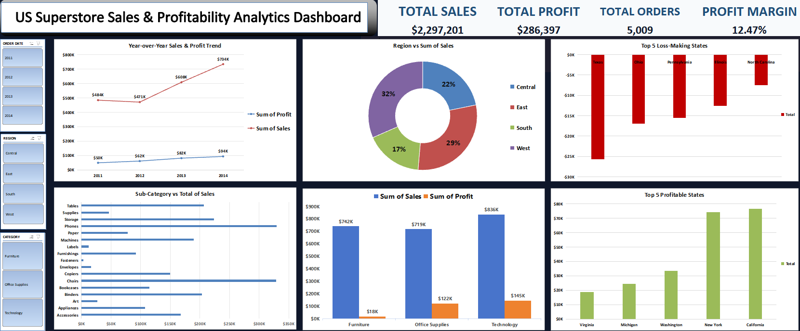

# US Superstore Sales & Profitability Analytics Dashboard (Excel)

An interactive executive dashboard built in **Excel** using **Power Query**, the **Data Model**, **Pivot Tables** and **Slicers**. It analyses US Superstore sales to find what drives revenue, which categories perform well, and which states lose money.

---

## Problem Statement

A US retailer generated about $2.3M in sales but earned only a 12.47% profit margin, and some states were losing money despite selling in them. This project analyses 9,994 order lines (2011 to 2014) to answer:

- How are sales and profit changing year over year?
- Which categories, regions and sub-categories drive revenue?
- Which states are the most profitable, and which ones are draining profit?

---

## Dashboard



---

## Dataset

| Item | Detail |
|---|---|
| File | `Superstore_Dataset.xlsx` (sheet: `Orders`) |
| Rows / Columns | 9,994 order lines, 21 columns |
| Unique orders | 5,009 |
| Period | 2011 to 2014 |
| Key columns | Order ID, Order Date, Ship Date, Ship Mode, Customer, Segment, City, State, Region, Category, Sub-Category, Sales, Quantity, Discount, Profit |

---

## Tools & Skills Used

### 1. Data Cleaning (Power Query)
- Structured the raw transaction data, handled missing values, standardised date fields (`Order Date`, `Ship Date`) and parsed geographic categories.
- Prepared clean tables for pivot table aggregation.

### 2. Data Modeling (Excel Data Model)
- Loaded the data into the Excel Data Model.
- Used **Distinct Count** on `Order ID` so unique orders are counted correctly (5,009) instead of the 9,994 row count.

### 3. Pivot Tables & Pivot Charts
- 9 pivot tables feeding the dashboard charts (sales, profit, region, category, sub-category, state, year).
- KPI cards linked to the pivots with `GETPIVOTDATA`; profit margin calculated as Profit / Sales.

### 4. Formatting
- Custom number format to show values in `$K` and `$M`:
  `[>=1000000]$#,##0.0,,"M";[>=1000]$#,##0,"K";$#,##0`
- Red fill for loss-making states and green fill for profitable states to draw attention quickly.

### 5. Interactivity
- Slicers for **Order Date (Year)**, **Region** and **Category**, connected to all pivot charts.

---

## Dashboard Visuals

- KPI cards: Total Sales, Total Profit, Total Orders, Profit Margin
- Year-over-year Sales & Profit trend
- Region vs Sales (donut chart)
- Sub-Category vs Total Sales
- Category: Sales vs Profit
- Top 5 Loss-Making States
- Top 5 Profitable States

---

## Key Findings

| Metric | Value |
|---|---|
| Total Sales | $2,297,201 (about $2.3M) |
| Total Profit | $286,397 |
| Total Unique Orders | 5,009 |
| Units Sold | 37,873 |
| Overall Profit Margin | 12.47% |

- **Sales dipped slightly in 2012, then grew strongly.** Sales went 484K (2011), 471K (2012), 608K (2013), 734K (2014). Profit rose every year: 50K, 62K, 82K, 94K.
- **Technology is the top revenue category** with $836K sales and $145K profit, followed by Furniture ($742K sales, $18K profit) and Office Supplies ($719K sales, $122K profit).
- **Region share of sales:** West 32%, East 29%, Central 22%, South 17%.
- **Most profitable states:** California ($76.4K) and New York ($74K) lead, followed by Washington, Michigan and Virginia.
- **Profit leakage:** Texas (-$25.7K) and Ohio (-$17K) are the biggest loss-making states, followed by Pennsylvania, Illinois and North Carolina. These markets need pricing restructuring and discount capping.

---

## Repository Structure

```
├── Dashboard_Overview.png                       # Dashboard screenshot
├── Superstore_Dataset.xlsx                      # Source dataset (9,994 rows)
├── SUPERSTORE SALES DATASET DASHBOARD.xlsx      # Excel workbook with pivots, charts and slicers
└── README.md
```

---

## Author

**Shrikant Pedde**
- GitHub: [@shrikantpedde](https://github.com/shrikantpedde)
- LinkedIn: [Shrikant Pedde](https://linkedin.com/in/shrikant-pedde-535b24320/)
